# Architecture

AbstractUIC is a **multi-package repository**: each folder at the repo root is an independently-consumable package.

Ecosystem context (external):
- AbstractFramework: https://github.com/lpalbou/AbstractFramework
- AbstractCore: https://github.com/lpalbou/abstractcore
- AbstractRuntime: https://github.com/lpalbou/abstractruntime

This document stays intentionally close to the code: package boundaries, exports, and contracts are backed by entrypoints/types in `src/` and by `exports` metadata in each `*/package.json`. References to the broader AbstractFramework ecosystem (AbstractCore / AbstractRuntime) are for context — AbstractUIC does not import those packages directly.

## High-level overview

- **React packages** ship **compiled ESM + type declarations** from `dist/` (see `exports` in each `package.json`). Source lives in `src/` and is built with `tsc`.
- **`@abstractframework/monitor-gpu`** and **`@abstractframework/monitor-memory`** ship **JavaScript** (`monitor-gpu/src`, `monitor-memory/src`) and register custom elements.
- **`@abstractframework/app-server`** ships Node.js JavaScript (`app-server/src`) with no runtime dependencies.
- Styling is shipped as plain CSS and exposed as package exports (e.g. `@abstractframework/panel-chat/panel_chat.css`).
- **Console islands** are a repository build output of `ui-kit` (`ui-kit/islands/`), not an npm export: one self-contained script for pages that are not React apps. See [Console islands](./console-islands.md).

## Packages and their consumers

The AbstractFramework apps consume the packages from npm (or as workspace links). The
AbstractGateway console is served from Python without an npm build, so it vendors generated
copies of the kit instead: the theme stylesheet and the console islands bundle. The AbstractCore
web console, also served from Python, generates its themes and the kit's `af-switch` and
`af-form` blocks from `theme.css` and `theme.ts` at sync time.

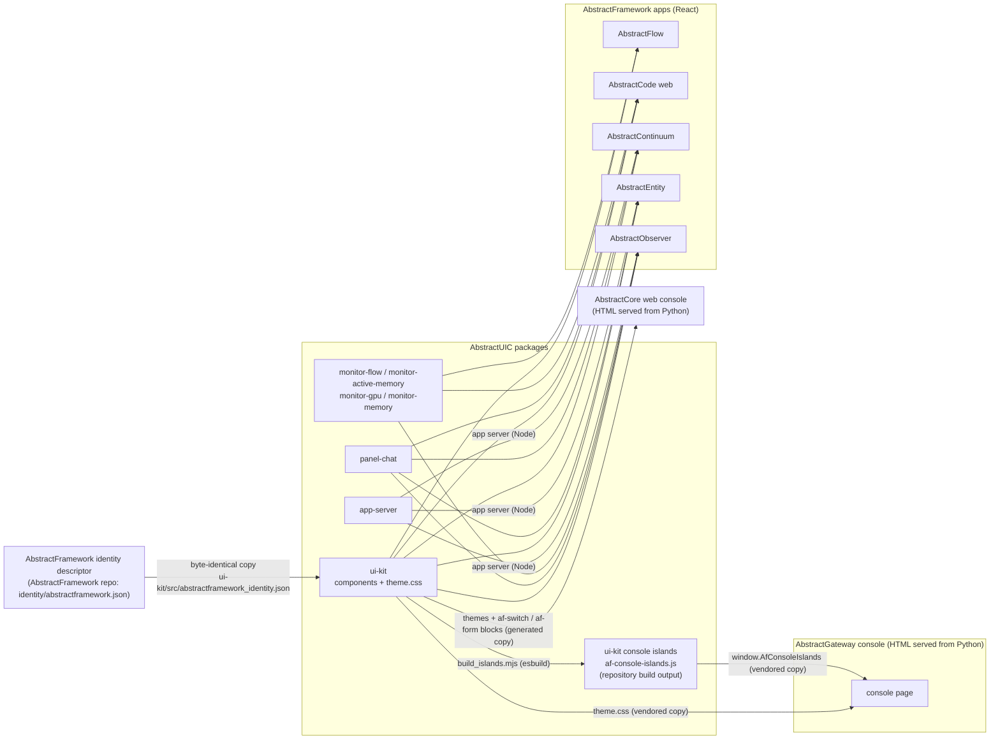

Every app renders its About dialog from the kit (`AfTopBarActions` `about` prop, or
`mountAbout` / the `about` prop of `mountTopBar` in the console). Monitor usage per app: AbstractFlow uses all four monitors; AbstractCode web uses
`monitor-flow` and `monitor-gpu`; AbstractObserver uses `monitor-flow`, `monitor-active-memory`
and `monitor-gpu`.

## Package dependency graph

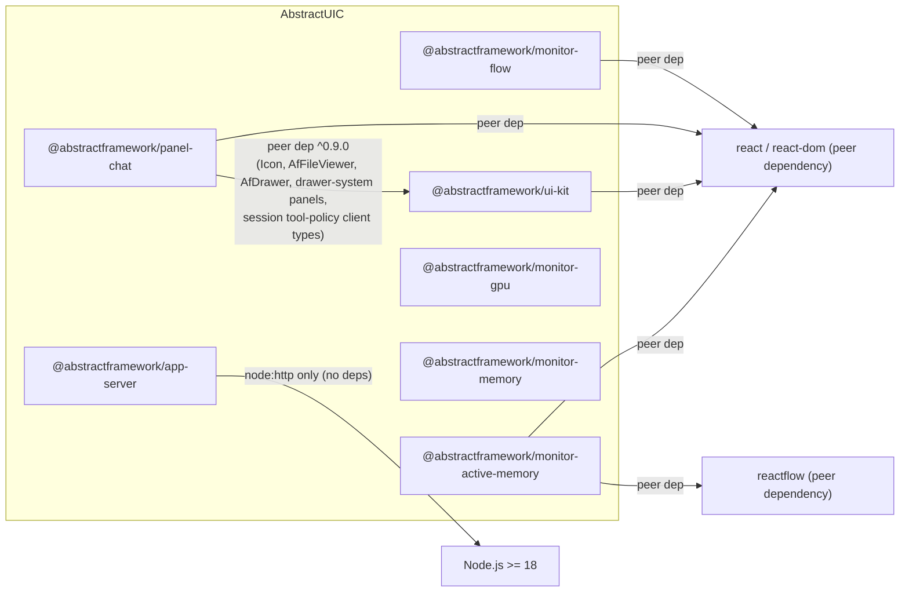

Evidence:
- panel-chat imports from `@abstractframework/ui-kit` (for example `Icon` in `panel-chat/src/chat_message_card.tsx`, `AfFileViewer` in `panel-chat/src/file_viewer.tsx`, the session tool-policy types in `panel-chat/src/workflow_runtime.ts`), declared as a peer dependency (`^0.9.0`) in `panel-chat/package.json`. Upgrade the two packages together; the repository's release gate (`scripts/check_cross_dist_types.mjs`) checks that the two built packages agree on the shared client types.
- `monitor-active-memory/package.json` declares `reactflow` (and `react` / `react-dom`) as peer dependencies.

## Design rules: one component per job (ADR 0001)

[ADR 0001](./adr/0001_shared_primitives_composed_on_gateway_contracts.md) is the rule the shared
components follow; the [Adoption guide](./adoption-guide.md) is its job table. In short:

- **One component per user-facing job** (the chat surface, questions and approvals, attachments
  and media, tool selection, the provider/model picker, voice, the app shell). An app that needs
  more adds a prop or slot to the kit; a copy in an app tree is a defect.
- **Composed on the gateway's contracts.** A component renders what the gateway serves (its
  routes, the run ledger, the served `waiting`, `discovery/capabilities`) through transports the
  host injects; it never re-derives server policy, and a missing value is a labeled fallback.
- **The gateway default is shown first** ("Gateway default · ollama / qwen3"), and an override can
  be undone ("Use gateway default").
- **One wording set per job**, decided in the kit (Deny / Allow once / Allow for this chat / Allow
  all enabled tools; Hold to talk / Tap to talk; Play sample).

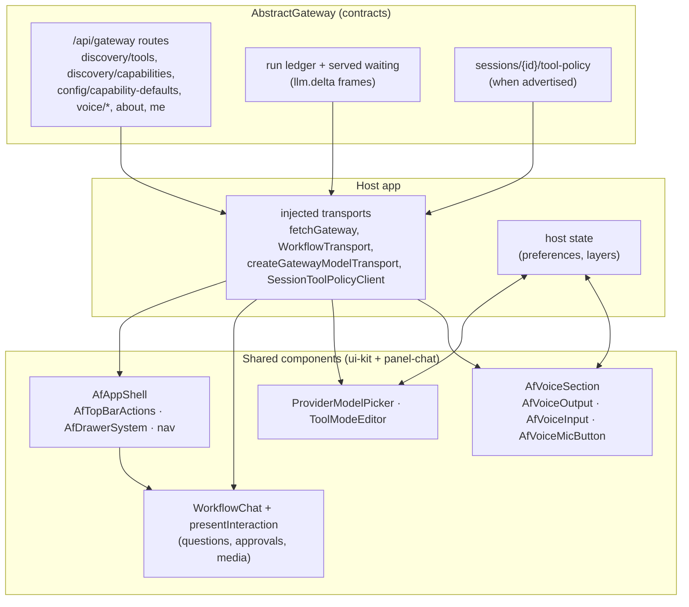

### The app shell

`AfAppShell` composes the header, the top-right cluster and the side panels. The cluster's order
is fixed by the kit; panels are opaque `{id, label, icon, content}` objects, so a new panel kind
mounts without an API change.

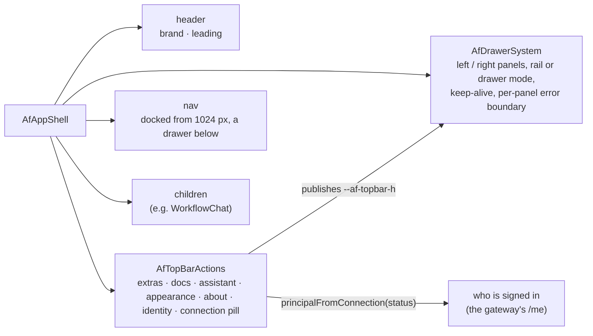

### Tool approvals and the chat's tool policy

When the gateway advertises `capabilities.session_tool_policy`, "Allow for this chat" and "Allow
all <toolset> tools for this chat" write the chat's policy first and only then answer the wait
shown, so later calls of every run of the chat run without a wait. Without the capability, the
grant stays local and labeled ("Allow for this run").

```mermaid
sequenceDiagram
  participant U as Person
  participant C as WorkflowChat (presentInteraction)
  participant S as WorkflowSessionController
  participant P as SessionToolPolicyClient (host-injected)
  participant G as AbstractGateway
  G-->>S: run waits for a tool approval (served waiting)
  S-->>C: interaction: Deny / Allow once / Allow for this chat / …
  U->>C: Allow for this chat
  C->>S: approveAllForSession(target)
  S->>P: merge({approve, ask}) with the chat's Ask tools
  P->>G: POST sessions/{id}/tool-policy
  G-->>P: policy (revision, scope, clamped)
  S->>G: answer the shown wait {approved: true}
  Note over C: "Applies: …" as served; "Not covered: …" for clamped entries
```

### One repository, several frameworks (convention)

The packages in this repository are JavaScript/TypeScript npm workspaces at the repository root,
and they are the first implementation of every job. ADR 0001 §9 fixes where ports to other
frameworks go when one is written: `python/` (Qt widgets), `rust/` (terminal components),
`swift/` (SwiftUI), and `contracts/` for what all languages share (the job and wording tables and
the gateway payload fixtures). None of these directories exists in this release: they are a
convention, not shipped code. A port is listed in the Adoption guide's job table with its
location.

## Runtime data flow

AbstractUIC components are designed to be **host-driven**: hosts provide data and callbacks; the packages do not import host code.

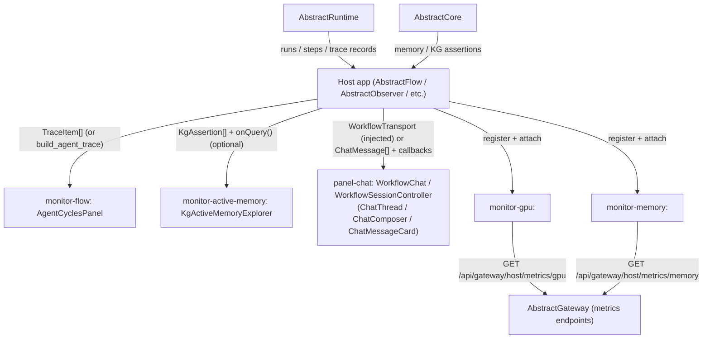

Evidence:
- `monitor-flow/src/AgentCyclesPanel.tsx` consumes `TraceItem[]` and groups cycles by `step.effect.type === "llm_call"`.
- `monitor-flow/src/agent_cycles_adapter.ts` exports `build_agent_trace(...)` to adapt ledger-like records into `TraceItem[]`.
- `monitor-active-memory/src/KgActiveMemoryExplorer.tsx` consumes `items: KgAssertion[]` and optionally calls `onQuery(params)`.
- `monitor-gpu/src/gpu_metrics_api.js` and `monitor-memory/src/memory_metrics_api.js` build/fetch the metrics URLs and attach Bearer auth headers.
- No direct dependency on AbstractCore/AbstractRuntime: see the absence of such dependencies in `*/package.json`.

## Contracts & types (what you pass in)

### Knowledge graph / active memory (`monitor-active-memory`)

- `KgAssertion` / `KgQueryParams` / `KgQueryResult`: `monitor-active-memory/src/types.ts`
- Graph utilities: `monitor-active-memory/src/graph.ts`
- Main component + callback contracts: `monitor-active-memory/src/KgActiveMemoryExplorer.tsx`

### Agent traces (`monitor-flow`)

- `TraceItem` / `TraceStep`: `monitor-flow/src/AgentCyclesPanel.tsx`
- Ledger adapter: `monitor-flow/src/agent_cycles_adapter.ts`

### Chat (`panel-chat`)

- `ChatMessage`, `ChatAttachment`, `ChatStat`, `ChatLiveReply`: `panel-chat/src/chat_message_card.tsx`
- `ChatThread` / `ChatComposer`: `panel-chat/src/chat_thread.tsx`, `panel-chat/src/chat_composer.tsx`
- `WorkflowTransport` / `WorkflowSessionController`: `panel-chat/src/workflow_runtime.ts`
- Live-reply events (`LlmDelta`, `LlmDeltaEnd`) and `streamRepliesRuntime`: `panel-chat/src/llm_delta.ts`
- Automation chat pieces (`ScheduleSeed`, `ScheduleThisAction`, `FromAutomationBadge`): `panel-chat/src/automation_badges.tsx`

### Automations (`ui-kit`)

- Wire shapes of the Gateway automation routes (`AutomationSummary`, `OccurrenceRow`, `CreateAutomationRequest`, …): `ui-kit/src/automations/types.ts`
- Client and error envelope parsing: `ui-kit/src/automations/client.ts`
- Pure presentation rules (controls, occurrence tones, labels, create body, retry-safe ids): `ui-kit/src/automations/panel_core.ts`
- Canonical examples: `ui-kit/scripts/fixtures/automations/*.json`

### GPU metrics (`monitor-gpu`)

The widget expects JSON that can be interpreted by `extractUtilizationGpuPct(payload)`:

- `payload.utilization_gpu_pct` (number) **or**
- `payload.gpus[][].utilization_gpu_pct` (numbers; averaged)

See: `monitor-gpu/src/gpu_metrics_api.js` and `monitor-gpu/src/monitor_gpu_widget.js`.

### Host memory metrics (`monitor-memory`)

The widget expects JSON that can be interpreted by `extractMemoryUsage(payload)` — the memory object directly or nested under `memory`:

- `ram.percent`, or `ram.used_bytes` / `ram.total_bytes` (used derivable from `total_bytes - available_bytes`)
- `device.backend` + `device.allocated_bytes` / `device.total_bytes` (allocated derivable from `total_bytes - free_bytes`)

A `404` or `supported: false` reply marks the endpoint unsupported and stops polling.

See: `monitor-memory/src/memory_metrics_api.js` and `monitor-memory/src/monitor_memory_widget.js`.

## Gateway connection flow (`app-server` + `ui-kit`)

Apps that talk to an AbstractGateway use the shared two-part connection surface: the
`app-server` session proxy on the app's own origin, and the `ui-kit` modal + hook in the
browser. The browser never holds the Gateway token.

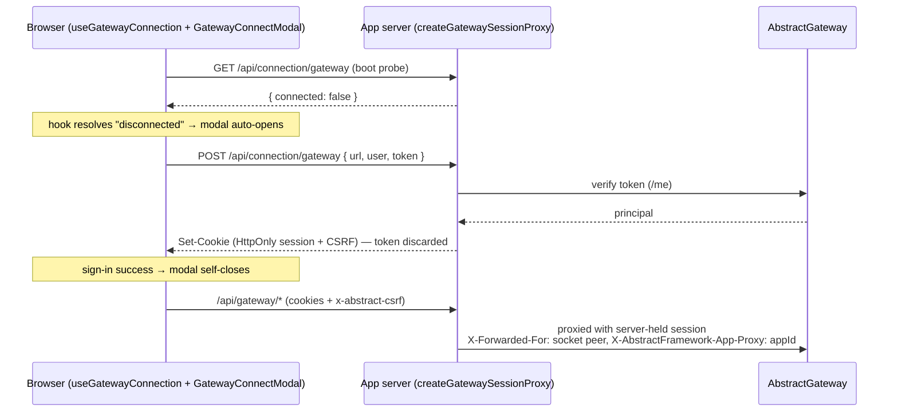

- Every request the proxy sends to the Gateway (the status probe, sign-in, sign-out and proxied
  `/api/*` calls) carries `X-Forwarded-For` set to the browser connection's socket address and
  `X-AbstractFramework-App-Proxy: <appId>`. Client-supplied forwarding headers and markers are
  replaced or dropped, never passed through, so the Gateway can tell whether the browser runs on
  its own machine. A connection whose socket address is unknown is refused with `400`.

- Contract details (auto-open rules, blocking vs dismissable, probe-once): see the
  [Adoption guide](./adoption-guide.md) and `ui-kit/README.md`.
- Evidence: `app-server/src/gateway_session_proxy.js`, `ui-kit/src/use_gateway_connection.ts`,
  `ui-kit/src/gateway_connect_modal.tsx`.

## Live replies (`panel-chat`)

When a run streams its model replies, the Gateway adds `llm.delta` and `llm.delta_end` events to
the run's ledger stream. The host transport hands them to `WorkflowSessionController`, which
shows one growing assistant bubble per model call until the durable ledger record replaces it.

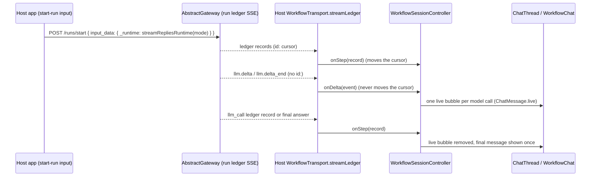

- `streamReplies` on `WorkflowChat` holds the host's "Stream replies" choice; the host maps it
  to `_runtime.stream` with `streamRepliesRuntime(mode)` (`"gateway_default"` leaves the key
  unset so the Gateway setting decides).
- A transport that does not pass `onDelta` keeps working: each reply appears when it is
  complete.
- Rules for bubbles (reconnect, sub-runs, failed or unavailable calls, render interval): see
  [`panel-chat/README.md`](../panel-chat/README.md#live-replies-streaming).

## About card and identity (`ui-kit`)

Every AbstractFramework app shows the same compact About card: the app's name and version, the
AbstractFramework and AbstractGateway versions, six links (Website, Source, Docs, Issues,
Feedback, Contact) and one copyright and licence line. It never lists packages. The identity
facts come from one descriptor that the kit ships as `ui-kit/src/abstractframework_identity.json`,
a byte-identical copy of the AbstractFramework repository's `identity/abstractframework.json`.
The kit never fetches: the app fetches the connected Gateway's versions and turns them into
`versions` with `aboutVersionsFromGateway`.

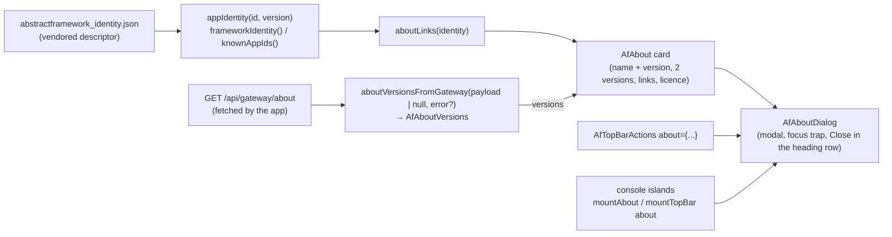

- The card markup matches AbstractCore's Python twin
  (`abstractcore.utils.identity.about_card_html`), used by the AbstractCore console.
- `aboutRows` and `gatewayVersionRows` stay exported for parity with the Python
  `about_fields` / `gateway_version_rows` (the shared fixture
  `ui-kit/scripts/fixtures/gateway_version_rows.json` pins both sides); the About card does not
  render rows.
- Details and examples: [`ui-kit/README.md`](../ui-kit/README.md#about-dialog-and-identity).

## Console islands (`ui-kit`)

The console islands expose the kit's `AfTopBarActions`, `AfAppearanceDialog` and
`AfAboutDialog` to a page that is not a React app, through a prop-driven global API.

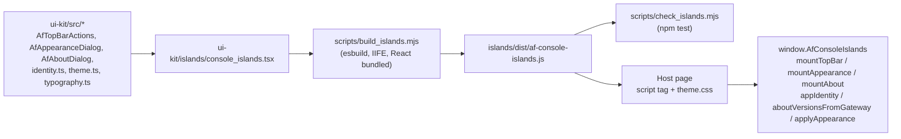

- The host owns all state and calls `handle.update(props)` when it changes.
- `apiVersion` (`"2"`) versions the island API; `kitVersion` records the `ui-kit` version the
  bundle was built from.
- The bundle carries no CSS; the host also serves `theme.css`.

Details, API and examples: [Console islands](./console-islands.md).

## Automations (`ui-kit` + `panel-chat`)

Apps show and manage AbstractGateway automations with the shared kit pieces. The host owns the
fetching: it calls the Gateway through `createAutomationsClient()` (with its own `fetch`, usually
through the `app-server` proxy), passes the results to `AutomationPanel`, and forwards the
panel's callbacks back to the client. Wait answers go through the Gateway's command route. The
canonical fixtures pin the wire shapes that the kit, AbstractObserver and AbstractAssistant test
against.

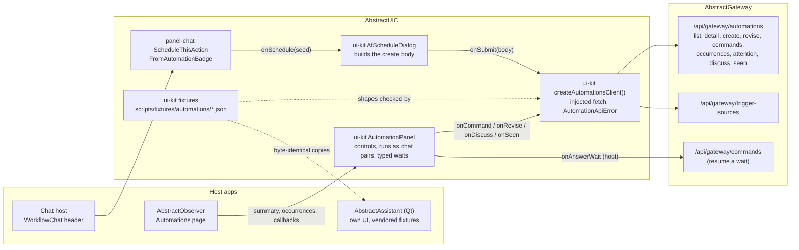

Details, props, the error model and the fixtures contract: [Automations](./automations.md).

## Voice settings and file preview (`ui-kit` + `panel-chat`)

Both surfaces are presentational: the kit never fetches by itself. The host passes the gateway
transports (`fetchDefaults`, `fetchCatalog`, `fetchGateway`) and stores the user's overrides.
"Gateway default · provider / model" in `AfVoiceSection` comes only from the gateway's voice
defaults; a request carries only the keys the user overrode. A workspace file is read through the
host's credentials and previewed in place; audio plays in the shared `AfAudioPlayer`.

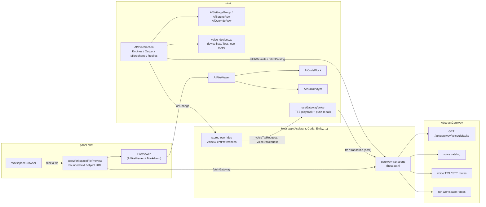

Props and helpers: [API reference](./api.md) (Voice section, File viewer, Audio player, Settings
rows) and the [panel-chat README](../panel-chat/README.md).

## Styling & theming

- `@abstractframework/ui-kit` provides CSS variables + theme classes in `ui-kit/src/theme.css` (exported as `@abstractframework/ui-kit/theme.css`) — 21 themes; see [Theming](./theming.md) for the token vocabulary and adoption rules.
- Other packages use those variables where available, but include fallbacks (e.g. `var(--ui-border-1, rgba(...))`).
- Non-CSS consumers can use the generated `ui-kit/palette_seeds.json` (4-token reduction per theme).
- Shared controls live in `theme.css` as blocks delimited by `<name>:begin` / `<name>:end` comments so the Python-served consoles can copy them: the sign-in card (`af-gateway-signin`), the switch (`af-switch`, see [On/off settings](./state-toggles.md)), forms, cards and tabs (`af-form`), the large modal (`af-modal`), account-row tints (`af-rows`) and grouped navigation (`af-nav`) (see [Modal, account rows, grouped navigation](./modal.md)).

See also: [Getting started](./getting-started.md) for integration + required CSS.

## Related docs

- Design rules: [ADR 0001](./adr/0001_shared_primitives_composed_on_gateway_contracts.md) and the [ADR index](./adr/README.md)
- Adoption guide (the job table): [Adoption guide](./adoption-guide.md)
- Getting started: [Getting started](./getting-started.md)
- API reference: [API reference](./api.md)
- Console islands: [Console islands](./console-islands.md)
- Automations: [Automations](./automations.md)
- Theming: [Theming](./theming.md)
- On/off settings: [On/off settings](./state-toggles.md)
- Modal, account rows, grouped navigation: [Modal](./modal.md)
- FAQ: [FAQ](./faq.md)
- Troubleshooting: [Troubleshooting](./troubleshooting.md)
- Docs index: [Docs index](./README.md)
- Development: [Development](./development.md)
- Package docs: see the table in the root [`README.md`](../README.md)
