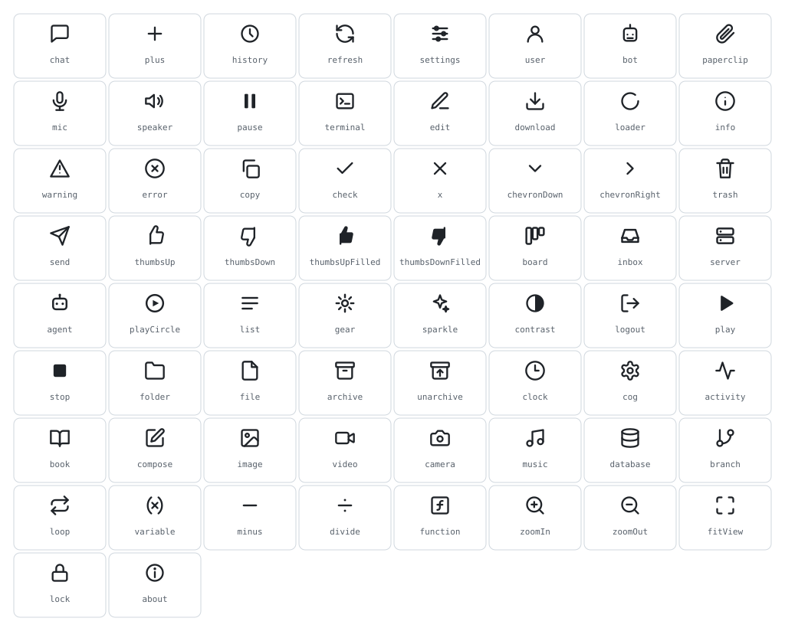
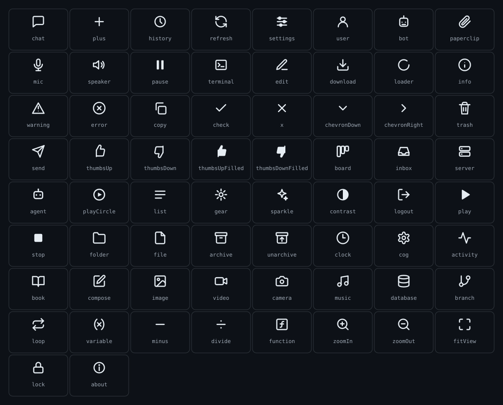

# Icons

`@abstractframework/ui-kit` ships one monochrome icon set for every AbstractFramework client: the
`Icon` component draws a named glyph in the current text colour (`currentColor`), so it follows
the active theme with no extra CSS.

```tsx
import { Icon, ICON_NAMES, type IconName } from "@abstractframework/ui-kit";

<Icon name="database" size={16} />          // decorative: aria-hidden
<Icon name="lock" size={16} title="Locked" /> // meaningful: role="img" with a <title>
```

- `name: IconName`: one of the names below. `size` (default 16) sets width and height in px.
  `title` makes the icon an image with an accessible name; without it the icon is hidden from
  assistive technology (put the name on the button instead, `aria-label`).
- `ICON_NAMES`: every name, in declaration order. Use it in a test to prove your own mapping only
  names icons that exist (AbstractFlow checks every node type this way).

## Contact sheet

Generated from the compiled package by `ui-kit/scripts/generate_icon_sheet.mjs`; the kit test
fails when a sheet is stale.





## Style

- **24-grid family** (most icons): `viewBox="0 0 24 24"`, stroke 2, round caps and joins, no
  fill. A solid part (a pupil, a dot, a filled twin) is a per-path `fill="currentColor"
  stroke="none"`.
- **16-grid family** (`board`, `inbox`, `server`, `agent`, `playCircle`, `list`, `gear`):
  `viewBox="0 0 16 16"`, stroke 1.4, kept verbatim from AbstractContinuum's navigation.
- Names are camelCase (`zoomOut`, `fitView`, `chevronDown`).

## Names

| Name | Grid | Typical use |
| --- | --- | --- |
| `chat` | 24 | Conversation, ask the user |
| `plus` | 24 | Add, new |
| `history` | 24 | Past runs, recall |
| `refresh` | 24 | Reload |
| `settings` | 24 | Settings (sliders) |
| `user` | 24 | Person, account |
| `bot` | 24 | Assistant |
| `paperclip` | 24 | Attach, artifact |
| `mic` | 24 | Record, transcribe |
| `speaker` | 24 | Read aloud, voice |
| `pause` | 24 | Pause (solid) |
| `terminal` | 24 | Command, code, tool call |
| `edit` | 24 | Edit |
| `download` | 24 | Download, import |
| `loader` | 24 | Busy (spin it with CSS) |
| `info` | 24 | Information |
| `warning` | 24 | Warning |
| `error` | 24 | Error |
| `copy` | 24 | Copy |
| `check` | 24 | Done, confirm |
| `x` | 24 | Close, remove |
| `chevronDown` | 24 | Expanded section |
| `chevronRight` | 24 | Collapsed section |
| `trash` | 24 | Delete |
| `send` | 24 | Send |
| `thumbsUp` | 24 | Vouch |
| `thumbsDown` | 24 | Flag |
| `thumbsUpFilled` | 24 | Vouch, pressed |
| `thumbsDownFilled` | 24 | Flag, pressed |
| `board` | 16 | Board, subflow |
| `inbox` | 16 | Inbox, incoming event |
| `server` | 16 | Server, provider |
| `agent` | 16 | Agent |
| `playCircle` | 16 | Start |
| `list` | 16 | List |
| `gear` | 16 | Settings (small) |
| `sparkle` | 24 | Generate, model call |
| `contrast` | 24 | Appearance |
| `logout` | 24 | Sign out |
| `play` | 24 | Run, active (solid) |
| `stop` | 24 | Stop, end (solid) |
| `folder` | 24 | Folder, workspace |
| `file` | 24 | File |
| `archive` | 24 | Archive |
| `unarchive` | 24 | Unarchive |
| `clock` | 24 | Time, schedule |
| `cog` | 24 | Settings (cog) |
| `activity` | 24 | Activity |
| `book` | 24 | Docs |
| `compose` | 24 | New conversation, write |
| `image` | 24 | Image (generate, edit, upscale) |
| `video` | 24 | Video |
| `camera` | 24 | Camera |
| `music` | 24 | Music |
| `database` | 24 | Stored memory, data store |
| `branch` | 24 | If / switch (one path in, several out) |
| `loop` | 24 | Loop, for, while |
| `variable` | 24 | Variable |
| `minus` | 24 | Subtract, zoom-out button without a magnifier |
| `divide` | 24 | Divide |
| `function` | 24 | Function, math operation |
| `zoomIn` | 24 | Zoom in |
| `zoomOut` | 24 | Zoom out |
| `fitView` | 24 | Fit everything in view |
| `lock` | 24 | Lock |
| `about` | 24 | About this app (the top bar's About button; a typographic "i" whose dot is wider than the stroke, in the same r 9 ring as `contrast`) |

## Adding an icon

1. Add the name to the `IconName` union and to `ICON_NAMES` in `ui-kit/src/icon.tsx` (the build
   fails when a union name is missing from `ICON_NAMES`), and draw it in `paths()` on the 24-grid.
2. Add its row to the table above.
3. `npm run build -w @abstractframework/ui-kit && node ui-kit/scripts/generate_icon_sheet.mjs`
   to regenerate the contact sheets.
4. `npm test -w @abstractframework/ui-kit`: `check_icons.mjs` renders every name and compares
   the union, `ICON_NAMES` and this table.

## Brand marks

The engines and cloud providers that the provider cards name are shown with the brand's own mark (`BrandMark`, or
`brandMarkHtml(id)` for hosts that build HTML as strings), inlined in `ui-kit/src/brand_icons.tsx`: no page fetches
a logo from anywhere. Each mark is drawn in its own colours on a light tile in every theme, because several brands
forbid recolouring. The source rules, in order: the brand's own press or brand-kit SVG when its terms allow using it
to identify the product; else the [Simple Icons](https://simpleicons.org) SVG (CC0 path data); else a readable text
badge. Trademarks belong to their owners; a mark identifies the product a card configures and implies no
endorsement, and the marks are not covered by the kit's MIT licence (OpenAI's is used under OpenAI's own Marks usage terms). `ui-kit/scripts/check_brand_icons.mjs` fails when a card id has neither a mark nor a documented fallback,
when a mark lacks its source, licence or date, or when a mark could reach outside itself.

| Id | Brand | Origin | Source file | Licence or terms | Retrieved |
| --- | --- | --- | --- | --- | --- |
| `ollama` | Ollama | brand | <https://raw.githubusercontent.com/ollama/ollama/main/docs/ollama-logo.svg> | File is in the MIT-licensed ollama/ollama repo (Copyright (c) Ollama); MIT covers copyright only. Trademark of Ollama. [Terms](https://ollama.com/terms). Ollama ToS: "These Terms do not grant you any rights to use our branding without permission." No published brand guidelines; no recolour rule. | 2026-10-29 |
| `lmstudio` | LM Studio | Simple Icons | <https://cdn.jsdelivr.net/npm/simple-icons@16.35.0/icons/lmstudio.svg> | CC0-1.0 (Simple Icons path data); icon contributed to Simple Icons by the LM Studio team (PRs simple-icons#14717, #14905); byte-identical to https://files.lmstudio.ai/lmstudio_icon2.svg. Trademark of Element Labs, Inc. [Terms](https://lmstudio.ai/brand). Brand page: "Do not recolor the logo or create unapproved color combinations." and "The permission we grant to you is non-exclusive and non-transferable." Identification is allowed: "Use LM Studio logo when referring to LM Studio". Simple Icons draws the path without a colour; it is filled with Simple Icons' recorded brand hex #000000 (black), the logo's own colour. | 2026-10-29 |
| `vllm` | vLLM | Simple Icons | <https://cdn.jsdelivr.net/npm/simple-icons@16.35.0/icons/vllm.svg> | CC0-1.0 (Simple Icons path data); traced from vllm-project/media-kit vLLM-Logo.svg @79b2ea5. Trademark of the vLLM project. [Terms](https://github.com/vllm-project/media-kit). media-kit README: "Don't modify or distort the logo proportions"; "Use the appropriate version for your background (light/dark)". No explicit recolour ban. Simple Icons draws the path without a colour; it is filled with Simple Icons' recorded brand hex #30A2FF (vLLM blue). | 2026-10-29 |
| `huggingface` | Hugging Face | brand | <https://huggingface.co/datasets/huggingface/brand-assets/resolve/main/hf-logo-monochrome.svg?download=true> | Official brand asset; the page says "Download the official Hugging Face brand assets to use in your projects." No licence or usage rules published (dataset has no card/licence). Trademark of Hugging Face, Inc. [Terms](https://huggingface.co/brand).  | 2026-10-29 |
| `mlx` | MLX | brand | <https://raw.githubusercontent.com/ml-explore/mlx/main/docs/logo/mlx_logo.svg> | File is in the MIT-licensed ml-explore/mlx repo (docs/logo, added in #3308). MIT covers copyright only; marks belong to Apple. [Terms](https://github.com/ml-explore/mlx). No logo usage guidelines published in the repo. | 2026-10-29 |
| `llamacpp` | llama.cpp | brand | <https://raw.githubusercontent.com/ggml-org/llama.cpp/master/media/llama1-icon-transparent.svg> | File is in the MIT-licensed ggml-org/llama.cpp repo (media/, added in #15891). MIT covers copyright; trademark of the ggml-org/llama.cpp project. [Terms](https://github.com/ggml-org/llama.cpp/blob/master/LICENSE). No logo usage guidelines published. | 2026-10-29 |
| `openai` | OpenAI | brand | <https://cdn.openai.com/brand/openai-logos.zip> | OpenAI logo (the black Blossom, OpenAI-logos/SVGs/OAI_OpenAI-Blossom_Black.svg in the zip, unmodified; sha256 75c1e9fffa5e8c437bec1d67197a73992bca45d166c6ff23215185dea8fae92a), a trademark of OpenAI, used under OpenAI's Marks usage terms (non-exclusive, non-transferable, revocable); NOT covered by this kit's MIT licence. Terms read: "By using our logos, you agree to our Marks usage terms." (https://openai.com/brand/) "Use the logo only when it directly relates to OpenAI services." (https://openai.com/brand/) "Use the logo exactly as provided and acknowledge that it belongs to OpenAI." (https://openai.com/brand/) "Permission to use our Marks is limited in the following ways: Only use our Marks if they adhere to these brand guidelines." (https://openai.com/brand/) "If you are an active OpenAI developer, you may truthfully identify the OpenAI technology you use." (https://openai.com/brand/) [Terms](https://openai.com/brand/). Shown exactly as provided, black, never recoloured or altered, only on the card that connects OpenAI's API (it "directly relates to OpenAI services"), never more prominent than the host's own name, with no partnership claim. Terms page read through the Wayback snapshot of 2026-10-21 (the live page answers 403 to non-browser clients). Counter-reading noted: "However, everything about your app, product or company (including name, logo, description, slogan, tagline and screenshots) should be your own and should be free of OpenAI's brands (including products, services or model names; logos; or trademarks)." (https://openai.com/brand/), read as being about the host's own branding. | 2026-10-29 |
| `openrouter` | OpenRouter | brand | <https://openrouter.ai/brand/logos/transparent/glyph/svg/glyph-ink.svg> | Official brand asset offered "ready to use"; no permission step or licence stated. Trademark of OpenRouter, Inc. [Terms](https://openrouter.ai/brand). "Please don't stretch, recolor, or remix the marks." Approved colourways only: Ink #03080A (light backgrounds) and Cloud #FCFCFE (dark backgrounds), plus Grape/Volt. | 2026-10-29 |

Text badges (no logo), each with the brand's own words:

| Id | Brand | Badge | Why there is no logo | Retrieved |
| --- | --- | --- | --- | --- |
| `anthropic` | Anthropic | ANT | Anthropic's trademark guidelines require its approval first: "You may only use our trademarks as specifically permitted by us and only in materials we approve beforehand. We may terminate permission to use our trademarks at any time." (https://www.anthropic.com/legal/trademark-guidelines) "We will supply an image (or images) of the trademark(s) for your use and specific requirements regarding size, pixels, spacing, and the like." (https://www.anthropic.com/legal/trademark-guidelines) "If you have an existing business relationship with Anthropic and want to use our trademarks in a press release, on your website, or in another context, please email marketing@anthropic.com." (https://www.anthropic.com/legal/trademark-guidelines) Its press kit (https://www.anthropic.com/press-kit) ships logos with no usage terms, so it grants no permission. [Terms](https://www.anthropic.com/legal/trademark-guidelines). | 2026-10-29 |
| `portkey` | Portkey | PK | Portkey's terms forbid displaying its marks without written permission, and it publishes no brand kit: "Except as set out in this section or elsewhere in our Legal Terms, no part of the Services and no Content or Marks may be copied, reproduced, aggregated, republished, uploaded, posted, publicly displayed, encoded, translated, transmitted, distributed, sold, licensed, or otherwise exploited for any commercial purpose whatsoever, without our express prior written permission." (https://portkey.ai/terms) "The Content and Marks are provided in or through the Services "AS IS" for your internal business purpose only." (https://portkey.ai/terms) [Terms](https://portkey.ai/terms). | 2026-10-29 |
| `ovh` | OVH AI Endpoints | OVH | OVHcloud's Trademark Usage Policy (version of 12/30/2024) allows its text trademark, not its logo: "1.2.Compatibility: You may use any OVHcloud Text Trademark (but not the OVHcloud Logo) in a referential phrase on promotional/advertising materials to describe that your product is compatible with the referenced OVHcloud product or technology, provided that the materials comply with the following requirements:" (https://www.ovhcloud.com/sites/default/files/external_files/trademark-usage-policy-en-30december-24.pdf) "Any other use of the OVHcloud Trademarks requires a separate trademark license agreement with OVHcloud. The use of OVHcloud Logos always require the written permission of OVHcloud." (https://www.ovhcloud.com/sites/default/files/external_files/trademark-usage-policy-en-30december-24.pdf) "1.2.OVHcloud Logo: You may not use the OVHcloud Logo on or in connection with websites, products, packaging, manuals, advertising materials, or for any other purpose except pursuant to an express written trademark licence from OVHcloud." (https://www.ovhcloud.com/sites/default/files/external_files/trademark-usage-policy-en-30december-24.pdf) [Terms](https://www.ovhcloud.com/sites/default/files/external_files/trademark-usage-policy-en-30december-24.pdf). | 2026-10-29 |
| `openai-compatible` | OpenAI-compatible server | API | A protocol, not a brand: any server that speaks the OpenAI API (vLLM, llama.cpp, LocalAI, a private gateway). No logo applies. | 2026-10-29 |

Adding a brand: add its id to `BRAND_CARD_IDS`, then either a `BRAND_ICONS` entry (the SVG's geometry and colours
unchanged; editor metadata, titles and classes dropped; ids namespaced `af-brand-<id>-`) with its source, terms,
licence, restrictions and date, or a `BRAND_FALLBACKS` entry saying why there is none; then a row above.
